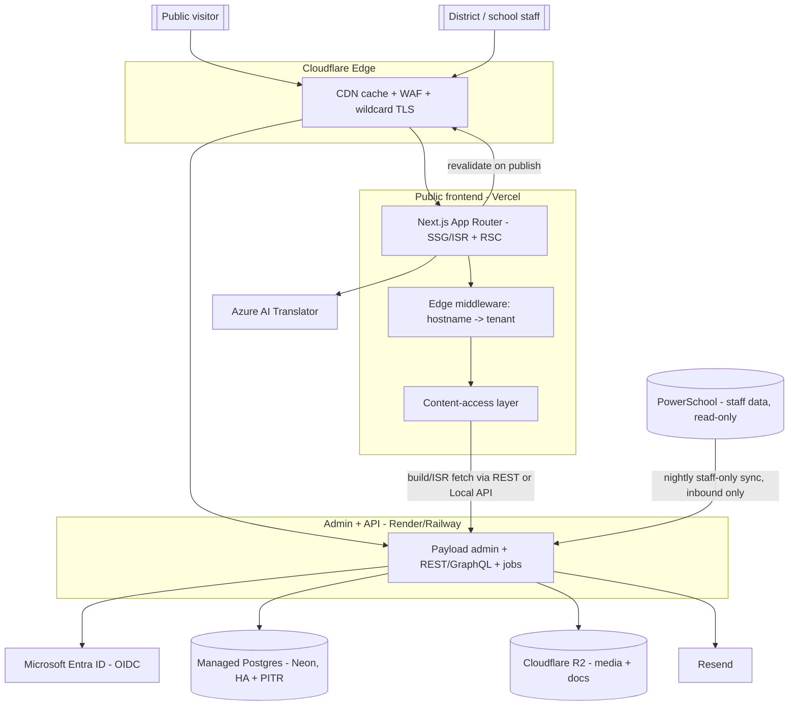

# 02 — System Architecture

## 1. Architectural stance

Four decisions define this system:

1. **Headless core, cached edge.** Payload owns content and admin; Next.js renders public
   pages as static/ISR artifacts served from a CDN. The public experience is a set of
   cached pages, not live database reads.
2. **Single codebase, tenant-scoped.** One deployment serves all 28 sites. The tenant is
   resolved from the request hostname; everything downstream is scoped to it.
3. **Availability by decoupling.** Because visitors hit cached pages, the editing backend
   and database are *not* in the public request path. Their outage pauses publishing, not
   serving.
4. **Payload behind a boundary.** The frontend never calls Payload directly. A
   content-access layer (§11) returns DD2 domain types, so the CMS is replaceable without
   rewriting the sites.

## 2. Technology stack

| Layer | Choice | Rationale |
|---|---|---|
| Language | **TypeScript** (end to end) | One language; schema-as-code; types flow from DB to UI. |
| CMS / admin / API | **Payload CMS 3**, pinned | Next.js-native, code-first schema, strong access control, REST + GraphQL + Local API, first-class multi-tenant plugin, drafts/versions/publish gate out of the box. MIT. |
| Front end | **Next.js (App Router)** | SSG/ISR, RSC, image optimization, edge middleware for tenant routing. |
| Database | **PostgreSQL** (+ `pgvector` reserved) | Relational integrity, FTS for search. **Postgres, never Mongo** — portability is a hard requirement (`00`). |
| DB layer | Payload's Postgres adapter (Drizzle) | Migrations generated from schema. |
| Auth | Payload auth + **Entra ID (OIDC) strategy** | District runs M365. No password storage, MFA and deprovisioning inherited from IT (§7). |
| Object storage | **Cloudflare R2** (S3 API) | Cheap, zero egress; media and document originals. |
| CDN / edge / DNS / WAF | **Cloudflare** | Caching, wildcard TLS for `*.district.org`, DDoS/WAF, edge redirects. |
| Translation | **Azure AI Translator** + owned cache | 100+ languages; inside the district's existing Microsoft relationship. Pipeline is ours and engine-agnostic (`08`). |
| Transactional email | **Resend** | Approval notifications and system alerts. Not mass communication. |
| Search | Postgres FTS at launch | No extra infrastructure; pgvector upgrade path preserved. |
| Forms | **Microsoft Forms**, embedded | Out of scope to build (`01` §5). Already licensed; submissions stay in the district tenant. |
| Testing | Vitest, Playwright, axe-core, Lighthouse CI, k6 | See `06`. |
| CI/CD | GitHub Actions | Standard, free-tier friendly. See `09`. |

**Plugins — deliberately minimal:** `@payloadcms/plugin-multi-tenant`,
`@payloadcms/plugin-cloud-storage` (R2). **Not used in v1:** `plugin-form-builder` — held as
a deferred add-on (`01` §4.2), not rejected. **Evaluated and not adopted:**
`@payloadcms/plugin-seo` (2026-09-21). Its admin fields hardcode hint text at 2.81:1 and
length indicators at 3.4–4.0:1 as inline styles, in 3.87.0 and still in 3.90.1, which fails
the admin-plane axe gate (`07` §2) with nothing but `!important` to fix it. The SEO fields
are two plain Payload fields in a group that keeps the plugin's name and stored shape
(`meta.title`, `meta.description`), so adopting it later is a config change, not a migration. No other plugin is adopted without weighing its
contribution to the swap cost (§11).

**Deliberately avoided:** MongoDB, local password authentication, drag-and-drop page
composition for school users, per-field manual localization as the primary mechanism
(`08` §2), browser `localStorage` for application state, and bespoke implementations of
anything Payload already provides.

## 3. Deployment topology



**Split deploys, one repo, one database.** The public frontend and the admin/API ship
independently so an admin deploy never risks public availability, and each scales and
fails on its own.

## 4. Multi-tenancy model

### 4.1 Tenant resolution
- Every request's `Host` maps to a tenant: `sms.district.org → tenant "summerville-ms"`,
  apex `district.org → tenant "district"`.
- **Edge middleware** resolves hostname → `tenantId` from a cached tenant map and injects
  it into the request context. Unknown host → 404 or redirect to district.
- Wildcard DNS `*.district.org` plus wildcard TLS means **adding a tenant is data, not
  DevOps**.

### 4.2 Data scoping
- **`@payloadcms/plugin-multi-tenant`** adds a `tenant` relationship to tenant-owned
  collections and auto-scopes reads and writes by the user's tenant assignment.
- **Cross-tenant leakage is prevented in the access-control layer** (`03` §6), not in the
  UI. Reads return *query constraints*, so lists are filtered server-side.
- Enforcement is verified by adversarial tests that attempt cross-tenant reads and writes
  as every role, run on every build (`06`).

> **Note on v2.0.** The custom design placed tenant isolation in Postgres row-level
> security, so a forgotten filter could not leak. Payload owns the connection and does not
> set per-request session variables, so isolation reverts to Payload's access functions —
> mature, query-constraint-based, and widely exercised, but application-layer. The
> adversarial test suite (`03` §6.4, `06`) is therefore **not optional**; it is the only
> thing standing where RLS would have stood.

### 4.3 Shared vs. scoped content
- *Scoped:* pages, posts, events, people, documents, media, navigation, theme, alerts.
- *Syndicable:* an item authored on the district tenant may be **referenced** (not copied)
  by school tenants — the COPE mechanism (§6). Syndicated *published* content is readable
  cross-tenant **by design**; nothing else is.

### 4.4 Theming
A `theme` global per tenant holds design tokens (logo, palette, type scale, hero style,
favicon). The shared component library reads tokens at render. No per-tenant CSS forks.
Per-locale typography tokens exist for CJK line-height and font stacks (`08` §6).

## 5. Public request & delivery flow

1. Visitor hits `school.district.org/athletics`.
2. Cloudflare serves cached, statically-generated HTML (edge hit) — **no origin call**.
3. On cache miss or stale, Vercel serves the ISR page; middleware has already resolved the
   tenant.
4. The page was built from Payload content at build/revalidate time **via the
   content-access layer** (§11). The database is touched at build/revalidate, never per
   visitor.
5. **Publish → revalidate:** a Payload `afterChange` hook triggers on-demand revalidation
   plus a Cloudflare tag purge for exactly the affected paths. Content goes live in
   seconds; everything else stays warm.

The only near-real-time element is the **alert bar**, a short-TTL edge fragment so
emergency updates propagate in seconds without a rebuild.

## 6. Content syndication (COPE)

- A syndicable item (district news post, district-wide alert) lives once on the district
  tenant.
- School tenants **reference** it via a syndication scope plus relationship, or subscribe a
  feed block (e.g. "District News" on a school homepage).
- Edits propagate by reference; revalidation purges every path that renders the item,
  tracked via cache tags keyed by document id. One edit, many live surfaces, one source of
  truth.

## 7. Authentication & authorization

- **Staff authentication is Entra ID (OIDC)** via a Payload custom auth strategy. No
  passwords are stored in the platform.
- **Entra group → Payload role mapping** at login: `district-admin`, `school-manager`.
  Tenant assignments are held on the Payload `users` document.
- **Deprovisioning is automatic** — when IT disables a district account, platform access
  ends with it. This is a material advantage over local accounts, where removal depends on
  someone remembering.
- **Break-glass:** one local Payload admin account for initial setup and Entra
  misconfiguration recovery. MFA-protected, audited, documented as an exception.
- **Staff-visible content** (`visibility: staff`) requires a valid session — no separate
  portal auth collection (`01` §4).

## 8. Availability & resilience (summary; detail in `09`)

| Component | Failure mode | Effect | Mitigation |
|---|---|---|---|
| Cloudflare edge | Cache hit | Site serves | Primary availability lever; ~99.99%. |
| Frontend (Vercel) | Down | Cached pages still served; ISR misses degrade | Stale-while-revalidate; multi-region edge. |
| Backend (Payload) | Down | Publishing and approvals pause; **public unaffected** | Decoupled path; redeploy. |
| Postgres | Down | Publishing pauses; public unaffected | Managed HA + PITR failover. |
| Entra ID | Down | Staff cannot log in; **public unaffected** | Break-glass account; no public dependency. |
| R2 | Down | New uploads fail; existing media edge-cached | CDN-cached assets; retry. |
| Translation API | Down | Cached translations still served; only new strings fall back to source | Translations cached in Postgres, not fetched per request (`08` §10). |
| PowerSchool | Down | Directory serves last-known-good | Sync is off the public path; never wipes (`11`). |

Composite public availability is governed by the CDN, not the serial product of every
service. This is how 99.9%+ is achieved without enterprise-tier SLAs on each layer.

## 9. Security architecture

- **AuthN:** Entra ID OIDC; no credential storage. Break-glass account excepted.
- **AuthZ:** function-based access control per collection and field, tenant-scoped, deny by
  default (`03` §6).
- **Tenant isolation:** enforced in access functions and query constraints, verified by
  adversarial tests every build (`06`).
- **Transport / at rest:** TLS everywhere; database and R2 encrypted at rest.
- **Input / abuse:** upload type and size allowlists with MIME verification; rate limiting
  on admin routes; CSP, HSTS, and standard security headers at the edge.
- **Rich text is constrained and normalized.** A fixed Lexical element allowlist (`p`,
  `h2`, `h3`, `strong`, `em`, `a`, `ul`, `ol`, `li`). Paste is normalized on entry, not
  sanitized on render (`07` §4). This is an accessibility control and a security control
  simultaneously.
- **Embeds are domain-allowlisted** (Microsoft Forms, approved schedule providers, approved
  video hosts). No free-form iframe source.
- **PII / FERPA:** no student data anywhere (`11`). Staff directory fields are work-contact
  information only.
- **Secrets:** platform secret stores only; never in the repository; rotated.

## 10. Localization placement

The translation pipeline (`08`) sits in the **frontend rendering layer**, not in Payload.
Strings are extracted at render, hashed, and resolved against a cache. This is deliberate:
it survives a CMS change untouched, it covers UI chrome that never lives in Payload
documents, it deduplicates across 28 near-identical tenants, and it cannot drift from
source.

**Payload's built-in field localization is enabled on a narrow set only** — the
`alertTemplates` collection and documents flagged `requiresTranslationReview` — where a
human translator's editing interface is genuinely wanted (`08` §7). Everything else,
including the entire Tier 2 language long tail, goes through the pipeline.

## 11. The content-access layer (the swap hedge)

**Rule: no file under `src/app/**` imports the Payload SDK.**

```
src/content/
  pages.ts      getPageBySlug(tenant, slug, opts) -> Page
  posts.ts      listPosts(tenant, filter) -> Post[]
  events.ts     listEvents(tenant, range) -> Event[]
  people.ts     listPeople(tenant, filter) -> Person[]
  documents.ts  listDocuments(tenant, filter) -> Document[]
  alerts.ts     getActiveAlerts(tenant) -> Alert[]
  types.ts      DD2 domain types — hand-written, not generated from Payload
```

- Functions accept a tenant context and return **DD2 domain types**, not Payload's
  generated types. The mapping happens once, inside this layer.
- Components, templates, and the translation pipeline consume domain types only.
- Swapping the CMS means rewriting ~8 files, not ~200 components.
- Enforced by an ESLint `no-restricted-imports` rule, not by convention.

This layer costs a few days and is the difference between "we could move if we had to" and
"we are married to this."

## 12. Key architectural decisions (ADR summary)

| ID | Decision | Alternatives rejected | Why |
|---|---|---|---|
| ADR-1 | Cached static/ISR public delivery | Live SSR per request | Availability, spike absorption, cost. |
| ADR-2 | Single multi-tenant codebase | 28 site instances | Maintainability; shared components; COPE. |
| ADR-3 | Split frontend/backend deploys | Single mounted app | Isolate public availability from admin changes. |
| ADR-4 | **Payload CMS 3, pinned** | Bespoke application (v2.0); Drupal; Strapi | A one-maintainer district cannot safely own a bespoke CMS long term. MIT caps the downside; §11 caps the switching cost. |
| ADR-5 | **Content-access layer mandatory** | Direct Payload calls from components | Converts an existential dependency into a bounded one. The hedge only exists if enforced from day one. |
| ADR-6 | **Entra ID OIDC for staff auth** | Payload local passwords | Removes the credential attack surface; automatic deprovisioning; no new password for infrequent users. |
| ADR-7 | Fixed page types for schools in v1; blocks for district | Universal page builder from day one | School layouts are currently identical and fixed types make inaccessible output hard to author. **Blocks are built, so extending them to schools later is an access change, not a rebuild** (`01` §4.1). |
| ADR-8 | **Render-layer translation pipeline** | Payload field localization as primary; Weglot | Staff will not author 6+ locales; derived-and-stored translations drift; pipeline dedups across 28 tenants and scales to a long tail (`08`). |
| ADR-9 | Payload localization for verified content only | All-or-nothing on either mechanism | Gives translators a real editing UI exactly where humans are involved, without the authoring burden elsewhere. |
| ADR-10 | Postgres, never Mongo | MongoDB | Portability is a hard requirement; relational data survives any CMS change. |
| ADR-11 | Aggressive paste normalization | Preserve pasted formatting; sanitize on render | Pasted Word markup is DD2's largest source of inaccessible content. Paste is the only cheap point to fix it (`07` §4). |
| ADR-12 | MS Forms in v1; native forms deferred | Building the form module now; permanent exclusion | 4 forms, no student data, already licensed. **The embed seam costs nothing and the form-builder plugin remains available** (`01` §4.2). Avoids maintaining an unused PII store. |
| ADR-13 | Documents remediated before upload | In-platform PDF/UA pipeline | Validation cannot remediate; a Java sidecar is real ops for information a policy plus attestation already provides (`07` §5). |
| ADR-14 | Postgres FTS at launch | Dedicated search service | Less infrastructure; pgvector upgrade path preserved. |
| ADR-15 | PowerSchool staff sync via OneRoster, read-only, inbound | SIS REST first; two-way sync; live per-request calls | Role-typed API cleanly excludes students; inbound-only plus last-known-good keeps the directory resilient and off the public path (`11`). |
