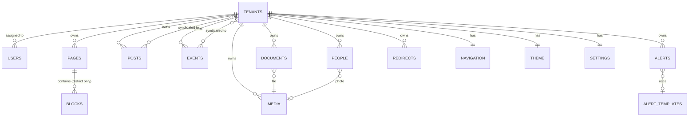

# 03 — Data Model & Access Control

Schema-as-code in Payload. This document is the source of truth for collections,
relationships, and the permission model. Field lists are the authoring contract, not
exhaustive.

**The most important section is §6.** With Payload, tenant isolation is enforced by access
functions rather than by the database (`02` §4.2). The adversarial test suite in §6.4 is
therefore load-bearing, not a formality.

## 1. Collection map



## 2. Collections

### `tenants`
The spine. One document per site (district + 27 schools).
- `name`, `slug`, `hostname` (unique, drives routing), `type` (`district` | `school`),
  `status` (`active` | `hidden`), `powerSchoolBuildingId` (nullable, for `11` §5).
- **Adding a tenant = creating a document.** DNS is already wildcarded. No deploy.

### `users`
Payload auth collection, backed by Entra ID (`02` §7).
- `email`, `name`, `entraObjectId` (unique — the durable identity), `roles`
  (`district-admin` | `school-manager`), `tenants` (relationship), `defaultTenant`,
  `lastLoginAt`.
- **`autoApprove`** — array of granted scopes (`events:schedule`, `posts:routine`), **empty
  by default**. Set only by a `district-admin`, per user, deliberately (`04` §4.3). Never
  defaulted by role, tenant, or collection. Changes to this field are audited.
- **No password is stored** for Entra-authenticated users. Roles and tenant assignments
  refresh from Entra group membership at login.
- The single break-glass local admin is an explicitly flagged document, MFA-protected and
  audited (`02` §7).

### `pages`
- `tenant`, `title`, `slug`, `pageType`, `parent` (self-relation for hierarchy/nav),
  `visibility` (`public` | `staff`), `seo` (group), `publishAt`, plus drafts/versions.
- `requiresTranslationReview` (bool) — gates locale publication for high-stakes content
  (`08` §7.1).

**`pageType` determines the editing shape:**

| `pageType` | Available to | Content |
|---|---|---|
| `standard`, `about`, `contact`, `staff`, `calendar`, `documents` | School managers | Fixed typed fields per type |
| `composed` | **District only** | `layout` — the block array (§3) |

Enforced by field-level access and admin conditions, not by UI convention. In v1
`school-manager` cannot create or convert to `composed`. **This is a single access
predicate** — enabling school-level composition later (`01` §4.1) changes that predicate
and adds editor guardrails; it does not require new collections, blocks, or templates.

### `posts` (news & announcements)
- `tenant`, `title`, `slug`, `excerpt`, `body` (constrained rich text), `category`,
  `heroImage` (relation to `media`, alt required), `publishedDate`, `visibility`.
- **`syndication`:** `scope` (`this-tenant` | `district-wide` | `selected`),
  `syndicatedTo` (relationship to `tenants`). Drives COPE feeds.

### `events` (calendars, meetings, athletics)
- `tenant`, `title`, `start`, `end`, `allDay`, `location`, `description`, `category`
  (`general` | `meeting` | `athletics` | `holiday` | …), `recurrence` (rRULE),
  `syndication` (as posts).
- **`agendaBody`** — constrained rich text. Staff paste from Word or Google Docs; the paste
  handler normalizes to the element allowlist and reconstructs real lists and headings
  (`07` §4). Source formatting is discarded, not preserved.
- **Athletics is a category, not a module** — no teams or rosters collection (`01` §5).
- Read-only **iCal** feed endpoints per tenant and category.

### `people` (staff directories)
- `tenant`, `name`, `title`, `department`, `email`, `phone`, `photo` (relation to `media`,
  alt required), `bio` (rich text), `visibility` (`public` | `staff`), `active`.
- **Sync provenance (`11`):** `source` (`manual` | `powerschool`), `powerSchoolId`
  (unique per tenant), `syncedAt`.
- **Field ownership:** source-owned fields (`name`, `title`, `department`, `email`,
  `phone`, building assignment, `active`) are **read-only in the admin** for
  `source: powerschool` records. CMS-owned fields (`bio`, `visibility`, local `photo`) are
  editable and **preserved across syncs**. `manual` records remain fully editable.
- **No student fields exist on this collection** — there is nowhere for student data to
  land.

### `media`
Payload upload collection → R2.
- `tenant`, `alt`, `isDecorative` (bool), focal point, generated derivatives.
- **`alt` is required unless `isDecorative` is true** — enforced by validation and by a
  `beforeValidate` hook, not only by the form.

### `documents`
- `tenant`, `title`, `category`, `file` (relation to `media`), `visibility`
  (`public` | `staff`), `remediationStatus` (`attested` | `not-attested` |
  `not-applicable`), `attestedBy`, `attestedAt`, `localeOf` (nullable — links a translated
  document to its English original, `08` §9).
- Upload requires explicit attestation that the document was remediated before upload
  (`07` §5). `not-attested` documents appear on the district dashboard as a work queue.
  **The platform records status; it does not remediate.**

### `alerts`
- `tenant` (or district for global), `template` (relation to `alertTemplates`, nullable),
  `variables` (JSON), `message` (free text, used when no template), `severity`
  (`info` | `warning` | `emergency`), `link`, `startAt`, `endAt`, `syndication`.
- Rendered as a short-TTL edge fragment so emergency updates propagate in seconds without a
  rebuild.

### `alertTemplates`
- `key`, `severity`, `body` (with named `{{variables}}`), `variableSchema`.
- **Payload field localization is enabled on this collection** for Tier 1 locales (`08`
  §7.2). Each template is human-verified once, up front, so an emergency alert publishes in
  every Tier 1 language instantly without machine translation under pressure.

### `redirects`
- `tenant`, `from`, `to`, `type` (301/302). Seeded from the Finalsite URL map (`10`).

## 3. Blocks (district composition only)

`composed` pages hold an ordered `layout` block array. Blocks are available to
`district-admin` only.

**Block types (representative):** `Hero`, `RichText`, `ImageText`, `CardGrid`, `Accordion`,
`CallToAction`, `Gallery`, `FeedBlock` (news/events, with tenant scope), `DocumentList`,
`StaffList`, `Embed` (domain-allowlisted), `Divider`, `AlertInline`.

Every block ships with:
- An AA-conformant template with **block-owned heading levels** — a block cannot produce a
  heading-order violation regardless of placement.
- Required accessibility fields where applicable (alt text, accessible names, `title` on
  embeds).
- **CSS logical properties only** — no `margin-left`, no `text-align: left`, anywhere. RTL
  support for Arabic depends on this from the first block (`08` §6).
- A Storybook entry and an axe test in the same PR (`06`).

## 4. Deferred collections (add-ons — see `01` §4)

Not built in v1, listed so their attachment points are explicit and nothing here forecloses
them:

| Add-on | Collections it would add | Attachment point in v1 |
|---|---|---|
| Native forms | `forms`, `submissions` (via `plugin-form-builder`) | Pages embed a form by URL today; a `FormBlock` slots into the existing block library. Retention/redaction policy is the genuinely new work. |
| School page composition | *(none)* | Access predicate on `pageType: composed` and the `layout` field (§2, `pages`). |
| Athletics module | `teams` | `events.category = 'athletics'` and `events.team` (nullable relation) already model the join. |
| Portal audiences | `portalUsers`, audience groups | `visibility: staff` on `pages` and `documents`. |
| PDF/UA batch validation | *(none)* | `documents.remediationStatus` already records the field a validator would set. |

**No speculative schema is created for these.** A nullable relation or an enum value is a
seam; an unused collection is maintenance.

## 5. Globals (per tenant)

- `theme` — design tokens (logo, palette, type scale, hero style, favicon) plus per-locale
  typography tokens for CJK line-height and font stacks (`08` §6).
- `navigation` — primary/utility/footer menus.
- `settings` — site title, contact block, social links, default SEO/OG,
  **`enabledLocales`** (`08` §2).

## 6. Access-control model

Deny by default, function-based, tenant-scoped. Enforced in the API layer — the admin UI
merely reflects it.

### 6.1 Roles

| Role | Scope | Capabilities |
|---|---|---|
| `district-admin` | All tenants | Everything: composed pages, blocks, syndication, alerts, theme, navigation, approvals, user/tenant assignment, translation verification. |
| `school-manager` | Assigned tenant(s) | Create and edit fixed-type pages, posts, events; upload media and documents in their tenant. **Cannot publish** — changes are submitted for approval (`04` §5). Cannot touch theme, navigation, syndication, alerts, blocks, or PowerSchool-sourced fields. |
| `system-sync` | Mapped tenant(s) | Non-human actor for the PowerSchool sync. May **only** upsert `people` source-owned fields in mapped tenants; no access to any other collection (`11`). |
| *(public)* | Resolved tenant | Read published, public-visibility content plus content syndicated to that tenant. Nothing else. |
| *(staff session)* | Resolved tenant | As public, plus `visibility: staff` pages and documents (`01` §4). |

### 6.2 Access rules (pattern)

```ts
// pseudocode — real functions live beside each collection config
const isDistrict = ({ req }) => req.user?.roles?.includes('district-admin')

const inTenant = ({ req, doc, data }) => {
  if (isDistrict({ req })) return true
  const allowed = req.user?.tenants?.map(String) ?? []
  return allowed.includes(String((doc ?? data)?.tenant))
}

export const access = {
  read:   ({ req }) => tenantConstraint(req),   // query constraint, never a boolean
  create: inTenant,
  update: inTenant,
  delete: isDistrict,
  // publish transition gated separately — school-manager is blocked at the hook level
}
```

- **Reads return a query constraint**, not a boolean, so lists are filtered server-side.
- **Public read** of published, public-visibility content is open (that is the website).
  Drafts, staff-visibility content, and version history are never publicly readable.
- **Publish gate:** the draft → published transition is permitted for `district-admin`
  only. `school-manager` submissions become change requests (`04` §5).
- **Field-level:** PowerSchool source-owned fields are read-only for
  `source: powerschool` records; `pageType: composed` and the `layout` field are
  district-only.

### 6.3 Localization access
Payload field localization is enabled only on `alertTemplates` and on documents flagged
`requiresTranslationReview`. Editing a non-default locale value requires `district-admin`
(or a future dedicated `translator` role). Everything else translates through the pipeline
and has no per-locale stored value (`08` §2, `02` §10).

### 6.4 Tenant-isolation invariants (must always hold — release-blocking)

1. A user without tenant T cannot read T's drafts, staff-visibility content, version
   history, or pending change requests.
2. A user without tenant T cannot create, update, or delete any T-owned document.
3. Syndicated *published* content is readable cross-tenant **by design**; nothing else is.
4. The public REST/GraphQL surface never returns drafts, staff-visibility content, version
   history, or user records.
5. A `school-manager` cannot transition any document to published by any route — API,
   admin, or bulk operation.

**These are tested adversarially on every build** (`06`). Because isolation is enforced in
the application layer rather than the database (`02` §4.2), this suite is the primary
guarantee, not a secondary check.

## 7. Versioning, audit, workflow

- **Drafts and versions** enabled on `pages`, `posts`, `events`, `documents` — full history
  and one-click rollback. The same mechanism carries pending change requests (`04` §5);
  there is no separate draft concept to maintain.
- **Audit trail:** Payload versions plus an `audit` hook recording actor, tenant,
  timestamp, and action for every publish, approve, reject, delete, and sync run.
- **Workflow:** `school-manager` submits → `district-admin` approves → published and
  revalidated. Direct publish is available to `district-admin` only.

## 8. Migration mapping (see `10` for procedure)

| Finalsite concept | Target |
|---|---|
| Composer page (school) | `pages` with a fixed `pageType` |
| Composer page (district, complex) | `pages` with `pageType: composed` + blocks |
| News post | `posts` |
| Calendar event | `events` |
| Meeting agenda (pasted content element) | `events.agendaBody` — **re-normalized through the paste pipeline, not carried over as markup** (`07` §4) |
| Athletics team/schedule | `events` with `category: athletics`; third-party schedule embeds preserved |
| Constituent/staff directory | `people` — **seeded from PowerSchool (`11`)**, not migrated from Finalsite |
| Form | Microsoft Forms embed (`01` §5) |
| File/document | `media` + `documents` with remediation attestation |
| Alert | `alerts` (+ `alertTemplates` for emergency messages) |
| Staff portal content | `pages` / `documents` with `visibility: staff` |
| Site/section URL | `redirects` |
