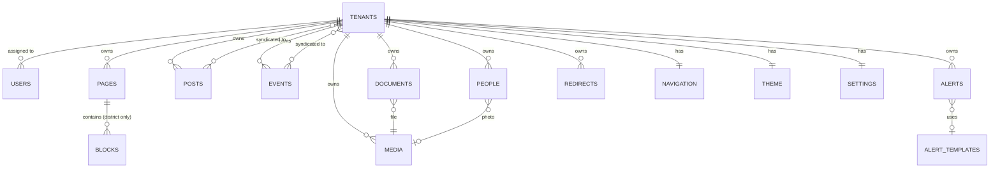

# 03 — Data Model & Access Control

Schema-as-code in Payload. This document is the source of truth for collections,
relationships, and the permission model. Field lists are the authoring contract, not
exhaustive.

**The most important section is §6.** With Payload, tenant isolation is enforced by access
functions rather than by the database (`02` §4.2). The adversarial test suite in §6.4 is
therefore load-bearing, not a formality.

## 1. Collection map



## 2. Collections

### `tenants`

The spine. One document per site (district + 27 schools).

- `name`, `slug`, `hostname` (unique, drives routing), `type` (`district` | `school`),
  `status` (`active` | `hidden`), `powerSchoolBuildingId` (nullable, for `11` §5).
- **Adding a tenant = creating a document.** DNS is already wildcarded. No deploy.

### `users`

Payload auth collection, backed by Entra ID (`02` §7).

- `email`, `name`, `entraObjectId` (unique — the durable identity), `roles`
  (`district-admin` | `school-manager`), `tenants` (relationship), `defaultTenant`,
  `lastLoginAt`.
- **`autoApprove`** — array of granted scopes (`events:schedule`, `posts:routine`), **empty
  by default**. Set only by a `district-admin`, per user, deliberately (`04` §4.3). Never
  defaulted by role, tenant, or collection. Changes to this field are audited.
- **No password is stored** for Entra-authenticated users. Roles and tenant assignments
  refresh from Entra group membership at login.
- The single break-glass local admin is an explicitly flagged document, MFA-protected and
  audited (`02` §7).

### `pages`

- `tenant`, `title`, `slug`, `pageType`, `parent` (self-relation for hierarchy/nav),
  `visibility` (`public` | `staff`), `seo` (group — stored as `meta`, see below),
  `publishAt`, plus drafts/versions.
- The SEO group is `meta.title` and `meta.description`: optional, plain fields, surfaced to
  the rendering layer as `Page.seo`. Both fall back at render — the title to the page's, the
  description to the first paragraph of the body — so a page nobody wrote them for is still
  described. A share image joins with `media` (Phase 6). `plugin-seo` was evaluated and not
  adopted (`02` §2); the group keeps its name and shape.
- `requiresTranslationReview` (bool) — gates locale publication for high-stakes content
  (`08` §7.1).

**`pageType` determines the editing shape:**

| `pageType`                                                       | Available to      | Content                         |
| ---------------------------------------------------------------- | ----------------- | ------------------------------- |
| `standard`, `about`, `contact`, `staff`, `calendar`, `documents` | School managers   | Fixed typed fields per type     |
| `composed`                                                       | **District only** | `layout` — the block array (§3) |

Enforced by field-level access and admin conditions, not by UI convention. In v1
`school-manager` cannot create or convert to `composed`. **This is a single access
predicate** — enabling school-level composition later (`01` §4.1) changes that predicate
and adds editor guardrails; it does not require new collections, blocks, or templates.

### `posts` (news & announcements)

- `tenant`, `title`, `slug`, `excerpt`, `body` (constrained rich text), `category`,
  `heroImage` (relation to `media`, alt required), `publishedDate`, `visibility`.
- **`syndication`:** `scope` (`this-tenant` | `district-wide` | `selected`),
  `syndicatedTo` (relationship to `tenants`). Drives COPE feeds.

### `events` (calendars, meetings, athletics)

- `tenant`, `title`, `start`, `end`, `allDay`, `location`, `description`, `category`
  (`general` | `meeting` | `athletics` | `holiday` | …), `recurrence` (rRULE),
  `syndication` (as posts).
- **`agendaBody`** — constrained rich text. Staff paste from Word or Google Docs; the paste
  handler normalizes to the element allowlist and reconstructs real lists and headings
  (`07` §4). Source formatting is discarded, not preserved.
- **Athletics is a category, not a module** — no teams or rosters collection (`01` §5).
- Read-only **iCal** feed endpoints per tenant and category.

### `people` (staff directories)

- `tenant`, `name`, `title`, `department`, `email`, `phone`, `photo` (relation to `media`,
  alt required), `bio` (rich text), `visibility` (`public` | `staff`), `active`.
- **Sync provenance (`11`):** `source` (`manual` | `powerschool`), `powerSchoolId`
  (unique per tenant), `syncedAt`.
- **Field ownership:** source-owned fields (`name`, `title`, `department`, `email`,
  `phone`, building assignment, `active`) are **read-only in the admin** for
  `source: powerschool` records. CMS-owned fields (`bio`, `visibility`, local `photo`) are
  editable and **preserved across syncs**. `manual` records remain fully editable.
- **No student fields exist on this collection** — there is nowhere for student data to
  land.

### `media`

Payload upload collection → R2.

- `tenant`, `alt`, `isDecorative` (bool), focal point, generated derivatives.
- **`alt` is required unless `isDecorative` is true** — enforced by validation and by a
  `beforeValidate` hook, not only by the form.

### `documents`

- `tenant`, `title`, `category`, `file` (relation to `media`), `visibility`
  (`public` | `staff`), `remediationStatus` (`attested` | `not-attested` |
  `not-applicable`), `attestedBy`, `attestedAt`, `localeOf` (nullable — links a translated
  document to its English original, `08` §9).
- Upload requires explicit attestation that the document was remediated before upload
  (`07` §5). `not-attested` documents appear on the district dashboard as a work queue.
  **The platform records status; it does not remediate.**

### `alerts`

- `tenant` (or district for global), `template` (relation to `alertTemplates`, nullable),
  `variables` (JSON), `message` (free text, used when no template), `severity`
  (`info` | `warning` | `emergency`), `link`, `startAt`, `endAt`, `syndication`.
- Rendered as a short-TTL edge fragment so emergency updates propagate in seconds without a
  rebuild.

### `alertTemplates`

- `key`, `severity`, `body` (with named `{{variables}}`), `variableSchema`.
- **Payload field localization is enabled on this collection** for Tier 1 locales (`08`
  §7.2). Each template is human-verified once, up front, so an emergency alert publishes in
  every Tier 1 language instantly without machine translation under pressure.

### `redirects`

- `tenant`, `from`, `to`, `type` (301/302). Seeded from the Finalsite URL map (`10`).

## 3. Blocks (district composition only)

`composed` pages hold an ordered `layout` block array. Blocks are available to
`district-admin` only.

### 3.1 The block register

Derived 2026-08-28 from a census of the Finalsite elements, modules, and layout elements DD2
uses today (§3.5). Batches are **dependency order, not priority** — a block cannot be built
before the collection it reads. 16 blocks; 8 have no unmet dependency.

**Batch 1 — no new collections; buildable against `pages` alone**

| Block          | Holds                                                                                                                                            |
| -------------- | ------------------------------------------------------------------------------------------------------------------------------------------------ |
| `RichText`     | Constrained rich-text body (§2, `07` §4). Wraps the existing component; `baseLevel` threaded as a prop                                           |
| `CallToAction` | Heading, short text, one link styled as a button                                                                                                 |
| `Accordion`    | Array of heading + rich text; the block owns the heading level                                                                                   |
| `CardGrid`     | Cards of title, blurb, link. Text-only until `media` lands                                                                                       |
| `ChildPageNav` | Auto-lists children of the current page via `pages.parent`. Covers Finalsite's Navigation _element_ — distinct from the `navigation` global (§5). Stores only an optional heading: the list is `Page.children`, resolved by the content layer and threaded through `BlockList` (§3.2) |
| `Embed`        | Domain-allowlisted iframe (`02` §7, `07` §6). Required `title`. Carries YouTube video (§3.4). **YouTube only, decided 2026-08-28** — see §3.3. Stores a pasted link and a title; the rendered `src` is rebuilt from constants on the no-cookie host, never the editor's string |
| `Divider`      | Decorative separator, `aria-hidden`                                                                                                              |

**Batch 2 — requires `media`**

| Block       | Holds                                                                             |
| ----------- | --------------------------------------------------------------------------------- |
| `Hero`      | Heading, optional subheading, image, optional link                                |
| `Image`     | Single image with optional caption; `alt` sourced from `media` (never re-entered) |
| `ImageText` | Image beside rich text, side selectable                                           |
| `Gallery`   | Grouped images                                                                    |

`CardGrid` gains its image field in this batch.

**`media` stays in Phase 6** (decided 2026-08-28). Batch 1 ships without images rather than
pulling `media` forward or accepting external image URLs as an interim — an image path that
bypasses `media` would also bypass alt-required-at-upload (rule 7).

**Batch 3 — requires Phase 5 collections**

| Block         | Requires                                                |
| ------------- | ------------------------------------------------------- |
| `FeedBlock`   | `posts` / `events`; honours syndication scope (`02` §6) |
| `StaffList`   | `people`, filtered by school or department              |
| `AlertInline` | `alerts`                                                |

**Batch 4 — requires Phase 6 collections**

| Block          | Requires                                            |
| -------------- | --------------------------------------------------- |
| `DocumentList` | `documents`; surfaces `remediationStatus` (`07` §5) |

### 3.2 The block contract

Every block ships with:

- An AA-conformant template with **block-owned heading levels** — a block cannot produce a
  heading-order violation regardless of placement. `baseLevel` is threaded as a prop; these
  are server components and server components have no context.
- Required accessibility fields where applicable (alt text, accessible names, `title` on
  embeds).
- **CSS logical properties only** — no `margin-left`, no `text-align: left`, anywhere. RTL
  support for Arabic depends on this from the first block (`08` §6).
- A Storybook entry and an axe test in the same PR (`06`).

**A block never fetches. Decided 2026-08-28.** `src/blocks/` may not import the Payload SDK
(rule 1), so a block renders its own row plus whatever the template threads down — today
`baseLevel` and, for `ChildPageNav`, the page's children.

`Page.children` sits on the **page**, beside `path` and `parentId`, because a page's position
in its own tree is a fact about the page rather than about any block that displays it —
breadcrumbs and a section menu want the same data. The content layer resolves it (one query in
`getPageByPath`; grouped in memory from the query `listPagePaths` already runs, so the
28-tenant build pays nothing). Only children with a **reachable URL** appear: drafts,
staff-only pages, and the front page's children are absent, because a menu entry that 404s is
worse than a missing one and would be cached (`02` §5).

Two consequences worth stating, since neither is obvious from the code:

- `ChildPageNav` is the **only** block whose emptiness the mapper cannot judge — its content is
  not in its own row — so the renderer drops it, and `BlockList` filters it before `Stack` can
  give a null block a gap on both sides. Everywhere else, emptiness is a mapper decision.
- It is the first **cross-document dependency in the render**: publishing a child changes the
  parent's page. The parent emits only its own `documentTag`, so whoever wires the revalidation
  hooks (`09` §4.2) has to purge the parent too.

This does **not** generalise to `FeedBlock`, `StaffList`, `DocumentList` or `Gallery`. Those
render an editor-**configured** query — a genuinely different problem, decided in Phase 5 when
the first of them is real rather than guessed at from the one block that did not need it. The
shape then most likely to fit is a resolve pass between the mapper and the renderer, keeping
`toPageBlocks` a pure function over JSON so the Phase 9 migration mappers can still run it with
no CMS (`10` §5).

### 3.3 Open — require a decision before building

| Item                                                     | State                                                                                                                                                                                                                                                                                                                                                                                                                                          |
| -------------------------------------------------------- | ---------------------------------------------------------------------------------------------------------------------------------------------------------------------------------------------------------------------------------------------------------------------------------------------------------------------------------------------------------------------------------------------------------------------------------------------- |
| **Column layouts** (2/3/4-column, wide-left, wide-right) | Nesting containers: blocks holding blocks. Cost is real — `baseLevel` threading to arbitrary depth, column _order_ (not just spacing) flipping under RTL, and an implicit mobile stacking order the editor never chose. `ImageText` and `CardGrid` cover most real uses without nesting. Recommendation: skip the general case; add a constrained 2-column (rich text either side, no nesting) only if the district site demonstrably needs it |
| **`Tabs`**                                               | Same nesting cost, plus content hidden from in-page search, print, and site search. Leaning no                                                                                                                                                                                                                                                                                                                                                 |
| **`SocialFeed`** (Facebook, Instagram)                   | In scope by `01` §5 — embeds _in_ are permitted. But `07` §6 makes third-party embeds DD2's accessibility obligation, and these widgets conform poorly and change without notice. Separately, they load third-party tracking onto pages visited by minors — **a district policy question, not a feature decision**. Low-cost alternative: a link-out card rather than a live feed. YouTube is unaffected; it goes through `Embed`              |
| **`Container`** | Listed in Batch 1 on 2026-08-28 and **withdrawn the same day**: a section wrapper's whole purpose is to contain other blocks, and blocks do not nest (§3.2). Without nesting it is a styling field wearing a block's clothes, which §3.2 also rules out. It belongs with the column layouts above — resolve those first, and `Container` either follows or stays unnecessary |
| **Widening the `Embed` allowlist** | YouTube only at launch (2026-08-28) — §3.4 folded `Video` into this block because YouTube is effectively DD2's only video source. Two candidates are held, and both are procurement steps rather than code changes, because `07` §6 requires a **current VPAT/ACR from the vendor before allowlisting**: (a) the **athletics schedule provider** `01` §5 says DD2 already embeds — nobody has named which one, so it is a template-census finding (`10` §2); (b) **Microsoft Forms**, below |
| **Whether MS Forms embedding is deferred** | `01` §5 has DD2's ~4 existing forms served by embedded MS Forms and calls that in scope; §3.4 records the 2026-08-28 deferral of `FormBlock` as also deferring "MS Forms embedding". If that meant only the native form builder, `forms.office.com` belongs in the allowlist and §3.4's wording needs narrowing. If it meant embedded forms too, `01` §5 needs correcting and those four forms need a stated home at cutover. **Left open 2026-08-28** |
| **Manual ordering for `ChildPageNav`** | The menu is alphabetical by title, which is the only deterministic order available — `pages` has no ordering field. Adding one is an authoring-model decision (a `sort` field every editor then has to maintain, and a second place the site's structure is expressed) rather than a block decision. Leave it until a real section reads wrong alphabetically |
| **`SharedBlock`**                                        | A genuine gap. Finalsite's shared elements have no equivalent — COPE syndication (`02` §6) covers `posts`, `events`, and `alerts`, not arbitrary page sections. Needs a snippets collection plus a decision on whether editing a shared element re-triggers approval on every page referencing it. Not first batch                                                                                                                             |

### 3.4 Not building — recorded so it is not re-proposed

| Item                                            | Why                                                                                                                                                                                                                                                                                                                                                                                                                                                                                                                                                                                          |
| ----------------------------------------------- | -------------------------------------------------------------------------------------------------------------------------------------------------------------------------------------------------------------------------------------------------------------------------------------------------------------------------------------------------------------------------------------------------------------------------------------------------------------------------------------------------------------------------------------------------------------------------------------------- |
| `Video`                                         | Folded into `Embed` (2026-08-28). YouTube is effectively the only source                                                                                                                                                                                                                                                                                                                                                                                                                                                                                                                     |
| Captions attestation on `Embed`                 | Not added (2026-08-28). YouTube captions are configured on YouTube, so a CMS field would record a claim rather than enforce a state. `07` §6's captions requirement stands as **policy**, owned by whoever publishes the video — not as a schema constraint                                                                                                                                                                                                                                                                                                                                  |
| `FormBlock`                                     | Deferred add-on (§4). MS Forms embedding deferred with it (2026-08-28)                                                                                                                                                                                                                                                                                                                                                                                                                                                                                                                       |
| Calendar Tools (subscription/aggregation feeds) | Not a DD2 need (2026-08-28). The `events` collection is unaffected — the `calendar` page type and Board agendas both sit on it                                                                                                                                                                                                                                                                                                                                                                                                                                                               |
| **Constituent**                                 | DD2's use would be **public staff data only**, which is already `people` — seeded read-only from PowerSchool (`11`) and rendered by `StaffList`. The module therefore has no distinct role here and is likely not needed at all (2026-08-28). The wider Finalsite feature set it belongs to — families, households, mailing lists, portal accounts — stays out regardless: no student data enters the platform (§6.4, `11` §4), and portal auth is a deferred add-on (§4). If a need surfaces beyond public staff data, that is a FERPA question for counsel before it is a feature question |

### 3.5 Provenance and what the register replaces

The register is derived from DD2's Finalsite element, module, and layout-element inventory,
**not** from its page layouts. Jason's decision of 2026-08-28: the new sites are designed
fresh and Finalsite layouts are not reproduced. This narrows the template census (`10` §2) —
its layout-recording half is dropped; its content inventory survives, since every real page
still needs a home in a fixed page type and a stranded content kind discovered at Phase 9 is
the expensive version of that finding. `01` §8's uniformity assumption becomes partly a
decision rather than a discovery: with a fresh design, all 28 schools can be declared to
share one page-type set, and the census need only surface a school whose content that
declaration would strand.

**Board** is not a module here. It decomposes into collections that already exist: agendas
to `events.agendaBody` (`10` §5), minutes and policies to `documents`, members to `people`.
Note the consequence — board material is PDF-heavy public-records content, so it loads with
`remediationStatus: not-attested` and is likely the largest single contributor to the `07` §5
remediation backlog whose ownership is still an open human decision (`00`).

**Post** and **Post Tools** are `posts` plus `syndication` (§2), already modelled.

## 4. Deferred collections (add-ons — see `01` §4)

Not built in v1, listed so their attachment points are explicit and nothing here forecloses
them:

| Add-on                  | Collections it would add                           | Attachment point in v1                                                                                                                      |
| ----------------------- | -------------------------------------------------- | ------------------------------------------------------------------------------------------------------------------------------------------- |
| Native forms            | `forms`, `submissions` (via `plugin-form-builder`) | Pages embed a form by URL today; a `FormBlock` slots into the existing block library. Retention/redaction policy is the genuinely new work. |
| School page composition | _(none)_                                           | Access predicate on `pageType: composed` and the `layout` field (§2, `pages`).                                                              |
| Athletics module        | `teams`                                            | `events.category = 'athletics'` and `events.team` (nullable relation) already model the join.                                               |
| Portal audiences        | `portalUsers`, audience groups                     | `visibility: staff` on `pages` and `documents`.                                                                                             |
| PDF/UA batch validation | _(none)_                                           | `documents.remediationStatus` already records the field a validator would set.                                                              |

**No speculative schema is created for these.** A nullable relation or an enum value is a
seam; an unused collection is maintenance.

## 5. Globals (per tenant)

- `theme` — design tokens (logo, palette, type scale, hero style, favicon) plus per-locale
  typography tokens for CJK line-height and font stacks (`08` §6).
- `navigation` — primary/utility/footer menus.
- `settings` — site title, contact block, social links, default SEO/OG,
  **`enabledLocales`** (`08` §2).

**How "per tenant" is expressed.** A Payload global is one document for the whole install, so
these are not Payload globals. Each is a tenant-scoped **collection** registered with
`plugin-multi-tenant` as `isGlobal: true`: the `tenant` field is unique, so the database holds
one row per tenant, and the admin opens that row directly instead of a list. All three are
district-only for every operation, reads included (§6.1); the public site reads them through
`src/content/*` with access overridden and an explicit tenant filter.

`theme` is built with a school's two colours. The **main colour** is the brand token — link
text and buttons — so it is checked against every contrast pair it appears in (`07` §3), when
saved and again when rendered; a failing palette is never served and the site falls back to the
default. The **second colour** is an accent used for decorative rules only, so any colour is
accepted; it gains a contrast pair the day a component puts text on it. Logo and favicon wait
for `media` (Phase 6) and hero style for the hero block; a type scale has no DD2 usage traced
to it and is not planned.

`navigation` is built: three flat menus of label / destination / new-tab. Destinations are a
string checked against an allowlist of four shapes — a site path, an `http(s)` address, `mailto:`
and `tel:` — by the field validator and again by the content mapper. Menus have no nesting; a
section's own pages are reached through `ChildPageNav` (§3.1).

`settings` is built: an optional site name that replaces the tenant's name wherever the site
names itself; a contact block (address, phone, email) and up to six social accounts from a
closed list of platforms, both rendered in the footer; a site description used only for a page
with no description and no prose of its own; and the enabled languages. Phone, email and social
addresses are checked by the field validator and again by the content mapper, as menu
destinations are. A default Open Graph image waits for `media` (Phase 6).

`enabledLocales` is one yes/no per Tier 1 locale, every one **on** by default, and English is
not among them because it cannot be turned off. Only an explicit "no" removes a language: a
tenant with no row, and a row saved before the platform gained a locale, both serve it. That
direction is deliberate — which languages DD2 must offer is a Title VI decision (`08` §10), so
the platform's failure mode is one language too many, never one too few. The list drives four
things that must agree: which locale prefixes are pages at all (any other 404s), `hreflang`,
the sitemap, and the language switcher. Tier 2 locales join it with the translation pipeline
(`08` §2, Phase 7).

## 6. Access-control model

Deny by default, function-based, tenant-scoped. Enforced in the API layer — the admin UI
merely reflects it.

### 6.1 Roles

| Role              | Scope              | Capabilities                                                                                                                                                                                                                                                |
| ----------------- | ------------------ | ----------------------------------------------------------------------------------------------------------------------------------------------------------------------------------------------------------------------------------------------------------- |
| `district-admin`  | All tenants        | Everything: composed pages, blocks, syndication, alerts, theme, navigation, approvals, user/tenant assignment, translation verification.                                                                                                                    |
| `school-manager`  | Assigned tenant(s) | Create and edit fixed-type pages, posts, events; upload media and documents in their tenant. **Cannot publish** — changes are submitted for approval (`04` §5). Cannot touch theme, navigation, syndication, alerts, blocks, or PowerSchool-sourced fields. |
| `system-sync`     | Mapped tenant(s)   | Non-human actor for the PowerSchool sync. May **only** upsert `people` source-owned fields in mapped tenants; no access to any other collection (`11`).                                                                                                     |
| _(public)_        | Resolved tenant    | Read published, public-visibility content plus content syndicated to that tenant. Nothing else.                                                                                                                                                             |
| _(staff session)_ | Resolved tenant    | As public, plus `visibility: staff` pages and documents (`01` §4).                                                                                                                                                                                          |

### 6.2 Access rules (pattern)

```ts
// pseudocode — real functions live beside each collection config
const isDistrict = ({ req }) => req.user?.roles?.includes('district-admin')

const inTenant = ({ req, doc, data }) => {
  if (isDistrict({ req })) return true
  const allowed = req.user?.tenants?.map(String) ?? []
  return allowed.includes(String((doc ?? data)?.tenant))
}

export const access = {
  read: ({ req }) => tenantConstraint(req), // query constraint, never a boolean
  create: inTenant,
  update: inTenant,
  delete: isDistrict,
  // publish transition gated separately — school-manager is blocked at the hook level
}
```

- **Reads return a query constraint**, not a boolean, so lists are filtered server-side.
- **Public read** of published, public-visibility content is open (that is the website).
  Drafts, staff-visibility content, and version history are never publicly readable.
- **Publish gate:** the draft → published transition is permitted for `district-admin`
  only. `school-manager` submissions become change requests (`04` §5).
- **Field-level:** PowerSchool source-owned fields are read-only for
  `source: powerschool` records; `pageType: composed` and the `layout` field are
  district-only.

### 6.3 Localization access

Payload field localization is enabled only on `alertTemplates` and on documents flagged
`requiresTranslationReview`. Editing a non-default locale value requires `district-admin`
(or a future dedicated `translator` role). Everything else translates through the pipeline
and has no per-locale stored value (`08` §2, `02` §10).

### 6.4 Tenant-isolation invariants (must always hold — release-blocking)

1. A user without tenant T cannot read T's drafts, staff-visibility content, version
   history, or pending change requests.
2. A user without tenant T cannot create, update, or delete any T-owned document.
3. Syndicated _published_ content is readable cross-tenant **by design**; nothing else is.
4. The public REST/GraphQL surface never returns drafts, staff-visibility content, version
   history, or user records.
5. A `school-manager` cannot transition any document to published by any route — API,
   admin, or bulk operation.

**These are tested adversarially on every build** (`06`). Because isolation is enforced in
the application layer rather than the database (`02` §4.2), this suite is the primary
guarantee, not a secondary check.

## 7. Versioning, audit, workflow

- **Drafts and versions** enabled on `pages`, `posts`, `events`, `documents` — full history
  and one-click rollback. The same mechanism carries pending change requests (`04` §5);
  there is no separate draft concept to maintain.
- **Audit trail:** Payload versions plus an `audit` hook recording actor, tenant,
  timestamp, and action for every publish, approve, reject, delete, and sync run.
- **Workflow:** `school-manager` submits → `district-admin` approves → published and
  revalidated. Direct publish is available to `district-admin` only.

## 8. Migration mapping (see `10` for procedure)

| Finalsite concept                       | Target                                                                                                   |
| --------------------------------------- | -------------------------------------------------------------------------------------------------------- |
| Composer page (school)                  | `pages` with a fixed `pageType`                                                                          |
| Composer page (district, complex)       | `pages` with `pageType: composed` + blocks                                                               |
| News post                               | `posts`                                                                                                  |
| Calendar event                          | `events`                                                                                                 |
| Meeting agenda (pasted content element) | `events.agendaBody` — **re-normalized through the paste pipeline, not carried over as markup** (`07` §4) |
| Athletics team/schedule                 | `events` with `category: athletics`; third-party schedule embeds preserved                               |
| Constituent/staff directory             | `people` — **seeded from PowerSchool (`11`)**, not migrated from Finalsite                               |
| Form                                    | Microsoft Forms embed (`01` §5)                                                                          |
| File/document                           | `media` + `documents` with remediation attestation                                                       |
| Alert                                   | `alerts` (+ `alertTemplates` for emergency messages)                                                     |
| Staff portal content                    | `pages` / `documents` with `visibility: staff`                                                           |
| Site/section URL                        | `redirects`                                                                                              |
