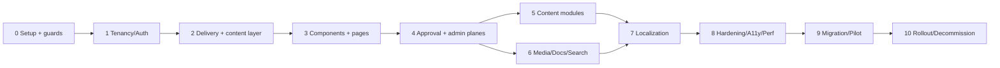

# 05 — Build Order & Roadmap

Sequenced so each phase produces something demonstrable, dependencies never run backward,
and the things that are cheap-now-expensive-later are done first. Phases are units of
*dependency*, not fixed calendar time; a rough single-developer (agent-assisted) estimate is
given for planning only.

## Guiding sequencing rules

1. **Foundations before features.** Tenancy, auth, access control, and the a11y-tested
   component primitives exist before any content module.
2. **Structural-or-never work lands early.** Three things are nearly free at the start and
   expensive to retrofit across a finished codebase: the **content-access layer** (`02`
   §11), **CSS logical properties** for RTL (`08` §7), and the **failing-closed axe gate**
   (`06`). All three are in place before the first component ships.
3. **The delivery/caching path is proven before content is built on it** (Phase 2), because
   the entire availability story depends on it.
4. **The approval workflow is built early** (Phase 4), immediately after the first content
   type exists — so every subsequent module plugs into a working review path rather than
   being retrofitted into one.
5. **Vertical slices.** Each content module is built end to end (schema → access → block →
   template → approval integration → migration mapper → tests) before the next.
6. **Migration tooling is built alongside the module it targets**, not saved for the end.
7. **Nothing merges without its tests and a clean axe run** (`06`, `07`).

---

## Phase 0 — Setup & guardrails *(est. ~1 week)*

**Goal:** a repository that enforces quality from commit one.

- Monorepo scaffold: Next.js App Router + Payload 3 (**pinned**) + TypeScript, Postgres
  locally (Docker). Payload repo **mirrored to the district GitHub org** (`00`).
- Tooling: ESLint/Prettier, Vitest, Playwright, axe-core, Lighthouse CI, k6 harness stubs.
- CI: typecheck → lint → unit → build → e2e smoke → **axe gate (failing-closed)**.
- **ESLint `no-restricted-imports` rule** forbidding the Payload SDK under `src/app/**`
  (`02` §11) — the swap hedge, enforced before there is anything to enforce it against.
- Design tokens and base theme structure, **written with CSS logical properties only**.
  Lint rule banning `margin-left`, `text-align: left`, and siblings.
- Environment config, secret management, `.env` contract documented.

**Exit:** green CI on an empty app; a11y gate wired and failing-closed; both lint guards
active.

## Phase 1 — Tenancy, auth & access control *(est. ~2 weeks)*

**Goal:** the multi-tenant, permission-enforcing spine.

- `tenants`, `users` collections; roles (`district-admin`, `school-manager`,
  `system-sync`); `@payloadcms/plugin-multi-tenant` wired.
- **Entra ID (OIDC) auth strategy** (`02` §7): group → role mapping, tenant assignment,
  break-glass local admin. *Slightly larger than v1.0's local auth; removes credential
  handling permanently.*
- Access functions and the isolation invariants (`03` §6.4) implemented.
- **Adversarial access tests written now** — cross-tenant read/write must fail across REST,
  GraphQL, admin, and bulk operations. Because isolation is application-layer rather than
  database-layer (`02` §4.2), this suite is the primary guarantee and is treated as such.

**Exit:** two dummy tenants provably non-leaking under adversarial test; staff log in with
district M365 credentials. **Dependency root for everything after.**

## Phase 2 — Delivery, caching & the content-access layer *(est. ~1.5 weeks)*

**Goal:** prove the availability model, and establish the boundary all content flows
through.

- **`src/content/*` content-access layer** with DD2 domain types (`02` §11). Everything
  after this phase consumes domain types, never Payload types.
- Public Next.js rendering via the layer; ISR + static generation.
- Cloudflare integration: caching, wildcard TLS, cache-tag strategy.
- **Publish → on-demand revalidate + tag purge** hook (COPE-ready).
- **Locale routing scaffolding**: `/{locale}/` path prefixes, `lang`/`dir` on `<html>`,
  `hreflang` emission. *No translation yet — just the routing shape, so nothing built later
  has to be re-plumbed.*
- Load-absorption smoke test.

**Exit:** a published page goes live in seconds on the right subdomain, served from edge
cache; killing the backend does **not** take the page down; `/es/` renders (untranslated)
with correct `lang`.

## Phase 3 — Component library & pages *(est. ~3 weeks)*

**Goal:** the accessible rendering foundation, plus both page-editing shapes.

- **Accessible component library**: each block with an AA-conformant template,
  **block-owned heading levels**, required a11y fields, Storybook entry, unit + axe tests
  (`07` §3).
- **Logical properties verified in RTL** — the layout is tested with `dir="rtl"` from the
  first component, not at localization time.
- Per-locale typography tokens (CJK line-height, font stacks) (`08` §7).
- `pages` with drafts/versions/live preview.
- **Fixed page types** (school) with typed fields; **`composed` type** (district) with the
  block array (`03` §2–3).
- Navigation global, SEO plugin, sitemap/robots.
- **Constrained rich text + paste normalization** (`07` §4) — the Lexical allowlist, list
  reconstruction, and heading-promotion prompt.

**Exit:** a district admin builds a themed, accessible composed page; a school-shaped fixed
page renders; pasted Word content normalizes to clean semantic markup; everything passes
axe with zero critical issues in both LTR and RTL.

## Phase 4 — Approval workflow & the two admin planes *(est. ~2.5 weeks)*

**Goal:** the workflow every later module plugs into.

- `reviewState` model on `pages` (`04` §4.1); publish transition gated to `district-admin`
  at access and hook level.
- **School plane:** custom root view with the task list, the single **"Send for approval"**
  control, constrained page creation, submission status (`04` §2).
- **District plane:** dashboard, cross-tenant list defaults, **approval queue with inline
  diffs and one-click approve** (`04` §3, §4.2).
- Auto-approval **grant** mechanism (`04` §4.3) — built, with **zero grants issued**.
- Rejection with note; Resend notifications; age-based escalation.
- **Both planes enter the axe gate and the keyboard-only task check** (`04` §6).

**Exit:** a school manager creates a page, sends it for approval, cannot publish by any
route; the district approves from a diff in one click and it goes live within seconds.

## Phase 5 — Core content modules *(est. ~3 weeks)*

**First, the audit trail** (`04` §8): every submit, approve, request-changes, auto-approve,
publish and delete records actor, tenant, timestamp and content type, auto-approvals marked as
such; grant changes recorded too (`04` §4.3). It is the first thing in this phase because the
modules below plug into it, and because no auto-approval grant may act until every
auto-approved change is recorded. *(Scheduled here at the Phase 4 close, 2026-10-27; `05`
previously placed it nowhere.)*

Then independent vertical slices, in order (each: schema → access → approval integration →
audit → block/feed → template → migration mapper stub → tests):

1. **News/announcements** (`posts`) + `FeedBlock` + COPE syndication.
2. **Calendars & events** (`events`) + iCal feeds + recurrence + **`agendaBody` with paste
   normalization**; athletics as a category.
3. **Directories** (`people`, `staff-groups`), **then the CSI staff sync** on top: system actor →
   source interface (mock until CSI access) → student-marker filter + mapper → locations → school
   groups → upsert → nightly job → tests **including the release-blocking no-student-data gate**
   (`11`). _(Was PowerSchool; corrected 2026-11-13.)_
4. **Alerts** (`alerts` + `alertTemplates`) as a short-TTL edge fragment, with the
   template-driven emergency path (`04` §3.4).

**Exit:** every approval-path action is in the audit trail; all four modules author,
syndicate, render, revalidate, and route through approval; district syndication reaches a school tenant; **a CSI sync populates the
schools' staff groups, student records are provably rejected, and a simulated
CSI outage leaves the directory serving last-known-good.**

## Phase 6 — Media, documents, staff visibility & search *(est. ~2 weeks)*

- **Media library** → R2, derivatives, **required alt enforced at upload** with the
  decorative escape hatch (`04` §2.5).
- **Document library**: category, `visibility`, **remediation attestation** and the
  district `not-attested` work queue (`07` §5). No validation pipeline (`01` §4.4).
- **`visibility: staff`** on pages and documents, gated by the Entra session (`01` §4.3).
- **Search**: Postgres FTS across public content, per-tenant and cross-tenant; results
  templated and accessible. pgvector left switchable.

**Exit:** an image cannot be uploaded without alt or a decorative flag; a staff-visibility
document is invisible to the public and visible to a signed-in staff member; search returns
scoped, accessible results.

## Phase 7 — Localization pipeline *(est. ~2 weeks)*

**Goal:** many languages, no authoring burden. Routing and `lang`/`dir` already exist from
Phase 2; the structural CSS work from Phase 3.

- String extraction, normalization, hashing; `translations` cache; Azure AI Translator
  client behind a swappable interface (`08` §4).
- `translation_overrides` with one-click correction from the rendered page; per-locale
  glossary (`08` §9).
- Tier 1 pre-render for high-traffic pages; Tier 2 on-demand.
- **Payload field localization enabled on `alertTemplates` and `requiresTranslationReview`
  content only** (`08` §3); verification workflow on the district dashboard.
- **Emergency alert template library** authored and human-verified in all Tier 1 locales
  (`08` §8.2).
- Accessible language switcher; RTL and CJK rendering verified across all templates.

**Exit:** every template renders correctly in all five Tier 1 locales with correct `lang`
and `dir`; an emergency alert publishes in every Tier 1 language from a template in under
60 seconds; a Tier 2 locale can be enabled by configuration alone.

## Phase 8 — Hardening, a11y audit & performance *(est. ~2 weeks)*

- Full **WCAG 2.1 AA audit** (automated + manual AT) across public templates, **both admin
  planes**, and sampled real pages; remediate to zero AA defects (`07`).
- Screen-reader passes in English and at least one RTL locale.
- Performance to Core Web Vitals targets; **CJK font strategy validated against the LCP
  budget** (`08` §7); k6 spike test to 100× from cache.
- Security review (OWASP ASVS L2), CSP/headers, dependency audit, **tenant-isolation
  re-test**.
- Error/empty/loading states; 404/500 pages per tenant.

**Exit:** all acceptance criteria in `01` §7 met on staging.

## Phase 9 — Migration & pilot cutover *(est. ~2–3 weeks)*

**Goal:** move content and go live without a gap. Full runbook in `10`.

- **Template census across all 28 sites** (`10` §2) — validates or falsifies the
  identical-layouts assumption in `01` §8 before rollout depends on it.
- Finish migration mappers; dry-run against real Finalsite exports; checksum verify.
- Legacy pasted content **re-normalized through the paste pipeline**, not carried as markup
  (`03` §8).
- **Pilot: migrate 1–2 school tenants**, run in parallel, validate with editors + a11y audit.
- Redirect map seeded; task-based UAT with real school managers (`01` §7.4).

**Exit:** pilot tenants validated; go/no-go for full rollout.

## Phase 10 — Rollout & decommission *(est. ~2–3 weeks)*

- Migrate remaining tenants in waves; validate each; cut DNS per tenant behind the CDN.
- Monitor; keep Finalsite live read-only until all tenants pass post-cutover checks.
- **Retire the Finalsite contract.** Portability export archived and **proven import-ready**
  (`00`).

**Exit:** 28 tenants live; contract terminated; savings realized.

---

## Dependency graph

**Rough total: ~21–23 weeks.** Comparable to v1.0 despite the scope cuts — forms,
athletics, portals, and the PDF pipeline came out, but Entra SSO, the approval workflow,
two custom admin planes, and the localization pipeline went in.

## Parallelization

With a single developer this is a straight line, but two things can move if capacity
appears: the **emergency alert template translations** (§Phase 7) are a procurement and
translator task that can start any time after the template list is written, and the
**template census** (§Phase 9) is inventory work that can begin during Phase 3 — earlier is
better, since it tests a load-bearing assumption.

## Definition of Done (every phase)

- Types clean; unit + integration + e2e tests written and passing.
- **Zero critical/serious axe violations** — public templates *and* admin planes.
- **RTL verified** for any new layout; logical properties only.
- Access-control and tenant-isolation tests still green.
- New user-facing surfaces reviewed against `07`.
- Content-access layer boundary intact (lint guard green).
- ADRs and docs updated; **add-on register reviewed** (`01` §4.4) — anything unrequested for
  a year is marked dead, not pending.
- Feature behind preview until acceptance.
